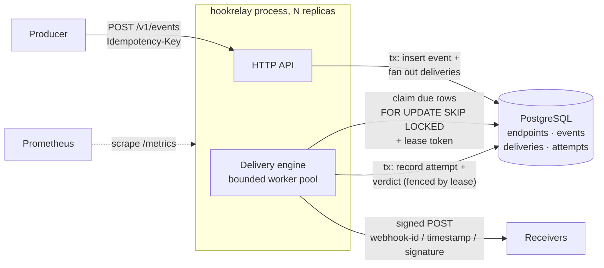
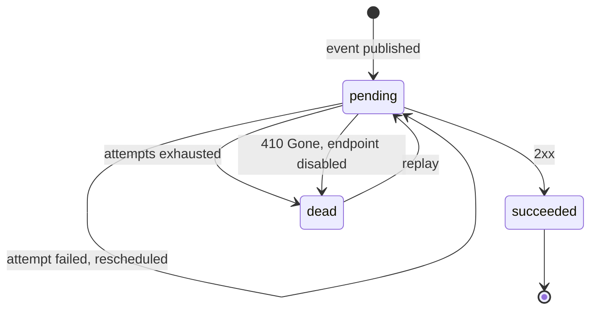

# hookrelay

[](https://github.com/marcus-girolneto/hookrelay/actions/workflows/ci.yml)
[](https://pkg.go.dev/github.com/marcus-girolneto/hookrelay)
[](https://goreportcard.com/report/github.com/marcus-girolneto/hookrelay)
[](LICENSE)

A reliable webhook delivery service in Go: durable fan-out, signed requests, retries with jittered backoff, dead-lettering and replay, on nothing but PostgreSQL.

## Why

Every platform that emits webhooks ends up building the same machinery: a queue that survives restarts, retries that do not hammer a struggling receiver, signatures receivers can verify, an audit trail of every attempt, and a way to replay what failed. Getting it subtly wrong produces either lost events or a thundering herd against a customer's endpoint.

hookrelay is a compact, production-shaped implementation of that machinery, similar in spirit to what Stripe and GitHub run internally. It is deliberately small enough to read in an afternoon, and each design trade-off is written down below.

## Features

- **HTTP API** to register endpoints (URL, signing secret, optional event-type filter), publish events, inspect deliveries and their attempts, replay dead-lettered deliveries, and re-enable endpoints.
- **Idempotent publishing**: `POST /v1/events` requires an `Idempotency-Key`. A retried publish returns the original event (`200`, `Idempotent-Replayed: true`); the same key with a different body is rejected (`422`).
- **Delivery engine**: a bounded worker pool claims due deliveries with `SELECT ... FOR UPDATE SKIP LOCKED`, so any number of instances can run against one database without double-claiming.
- **Retry policy**: capped exponential backoff with full jitter, a per-request timeout, `Retry-After` honoured on `429`/`503`, dead letter after a configurable number of attempts, and `410 Gone` disabling the endpoint and dead-lettering its backlog.
- **Signatures** following the [Standard Webhooks](https://www.standardwebhooks.com) spec (`webhook-id`, `webhook-timestamp`, `webhook-signature`, HMAC-SHA256), with an importable, dependency-free [`signature`](signature) package for receivers. Fuzz-tested and checked against the spec's test vector.
- **Leases with fencing tokens**: row locks are held only for the claim statement, never during HTTP calls; a late result from a worker whose lease expired cannot overwrite newer state.
- **Observability**: Prometheus metrics (attempts by outcome, attempt latency histogram by response class, queue depth, in-flight attempts, lease losses, store errors, API latency by route) and structured JSON logs via `log/slog`.
- **Graceful shutdown**: readiness flips to failing, the HTTP server drains, and in-flight deliveries complete and are recorded before exit.
- **Embedded migrations** applied at startup under a Postgres advisory lock.
- **Demo stack**: `docker compose up` starts Postgres, hookrelay and an example receiver that verifies signatures, deduplicates, and fails 30% of first attempts so retries are visible.

## Quick start

Requirements: Docker. For development, Go 1.27+.

```sh
git clone https://github.com/marcus-girolneto/hookrelay
cd hookrelay
docker compose up -d --build
curl -s localhost:8080/readyz
```

The API listens on `:8080` (with `/metrics` on the same port). The example receiver listens on `:8081` inside the compose network as `http://receiver:8081/webhooks` and is configured with the secret `whsec_ZGVtby1zZWNyZXQtZG8tbm90LXVzZS1pbi1wcm9k`.

To run the binary directly against your own database:

```sh
make build
HOOKRELAY_DATABASE_URL="host=localhost user=hookrelay password=hookrelay dbname=hookrelay sslmode=disable" ./bin/hookrelay
```

## Usage

Everything below is a real session against the compose stack (IDs and timestamps are from that run).

### Register an endpoint

```console
$ curl -s -X POST localhost:8080/v1/endpoints -H 'Content-Type: application/json' -d '{
    "url": "http://receiver:8081/webhooks",
    "event_types": ["invoice.paid"],
    "secret": "whsec_ZGVtby1zZWNyZXQtZG8tbm90LXVzZS1pbi1wcm9k"
  }'
{
  "id": "ep_01m54vxwb5tv83hvxxjp94yx8z",
  "url": "http://receiver:8081/webhooks",
  "event_types": [
    "invoice.paid"
  ],
  "disabled": false,
  "created_at": "2026-10-17T12:03:32.837116Z",
  "secret": "whsec_ZGVtby1zZWNyZXQtZG8tbm90LXVzZS1pbi1wcm9k"
}
```

Omit `secret` and one is generated. The secret is only returned on creation.

### Publish an event

```console
$ curl -s -X POST localhost:8080/v1/events \
    -H 'Content-Type: application/json' \
    -H 'Idempotency-Key: inv-1' \
    -d '{"type":"invoice.paid","payload":{"invoice":"in_1001","amount":4200}}'
{
  "event": {
    "id": "evt_01m54vxwgc6qhhpr50xdh8vfbj",
    "type": "invoice.paid",
    "payload": {
      "invoice": "in_1001",
      "amount": 4200
    },
    "created_at": "2026-10-17T12:03:33.004878Z"
  },
  "deliveries": [
    {
      "id": "dlv_01m54vxwgf57vfabdarny7m5nw",
      "event_id": "evt_01m54vxwgc6qhhpr50xdh8vfbj",
      "endpoint_id": "ep_01m54vxwb5tv83hvxxjp94yx8z",
      "status": "pending",
      "attempt_count": 0,
      "next_attempt_at": "2026-10-17T12:03:33.004878Z",
      "created_at": "2026-10-17T12:03:33.004878Z",
      "updated_at": "2026-10-17T12:03:33.004878Z"
    }
  ]
}
```

Publishing again with the same key and body returns the original event instead of creating a second one; changing the body under the same key is an error:

```console
$ curl -s -i -X POST localhost:8080/v1/events -H 'Content-Type: application/json' \
    -H 'Idempotency-Key: invoice-in_1042-paid' \
    -d '{"type":"invoice.paid","payload":{"invoice":"in_1042","amount":4200,"currency":"EUR"}}' | head -3
HTTP/1.1 200 OK
Content-Type: application/json
Idempotent-Replayed: true

$ curl -s -X POST localhost:8080/v1/events -H 'Content-Type: application/json' \
    -H 'Idempotency-Key: invoice-in_1042-paid' \
    -d '{"type":"invoice.paid","payload":{"invoice":"in_1042","amount":9999}}'
{
  "error": {
    "code": "idempotency_key_reused",
    "message": "Idempotency-Key was already used with a different request"
  }
}
```

### Watch a retry

The demo receiver answered `503` with `Retry-After: 2` twice before accepting this one. The attempts show the server-requested two-second spacing:

```console
$ curl -s localhost:8080/v1/events/evt_01m54vxwk65s1a04gr2cbg1vnh/deliveries
{
  "data": [
    {
      "id": "dlv_01m54vxwk63be1bgzhh58mtt0b",
      "event_id": "evt_01m54vxwk65s1a04gr2cbg1vnh",
      "endpoint_id": "ep_01m54vxwb5tv83hvxxjp94yx8z",
      "status": "succeeded",
      "attempt_count": 3,
      "created_at": "2026-10-17T12:03:33.094097Z",
      "updated_at": "2026-10-17T12:03:37.962527Z",
      "attempts": [
        {
          "number": 1,
          "started_at": "2026-10-17T12:03:33.417893Z",
          "duration_ms": 22.94,
          "status_code": 503,
          "error": "unexpected status 503",
          "response_body": "simulated outage\n"
        },
        {
          "number": 2,
          "started_at": "2026-10-17T12:03:35.948222Z",
          "duration_ms": 3.882,
          "status_code": 503,
          "error": "unexpected status 503",
          "response_body": "simulated outage\n"
        },
        {
          "number": 3,
          "started_at": "2026-10-17T12:03:37.961477Z",
          "duration_ms": 1.02,
          "status_code": 204
        }
      ]
    }
  ]
}
```

The corresponding logs (`docker compose logs`, some fields removed for width):

```json
{"level":"WARN","msg":"delivery attempt failed","component":"delivery","delivery_id":"dlv_01m54vxwk63be1bgzhh58mtt0b","attempt":1,"status":503,"outcome":"retry","error":"unexpected status 503","next_attempt_at":"2026-10-17T12:03:35.441109131Z"}
{"level":"INFO","msg":"delivered","component":"delivery","delivery_id":"dlv_01m54vxwk63be1bgzhh58mtt0b","attempt":3,"status":204,"outcome":"succeeded"}
{"level":"INFO","msg":"webhook received","webhook_id":"evt_01m54vxwk65s1a04gr2cbg1vnh","type":"invoice.paid","data":"{\"invoice\":\"in_1003\",\"amount\":4200}"}
```

### Dead letter and replay

An endpoint that keeps failing (here a path that returns `404`) is dead-lettered after `max-attempts` (5 in the compose file). Output trimmed:

```console
$ curl -s localhost:8080/v1/events/evt_01m54vz82grrbsa5qqc1xy5nz3/deliveries
{
  "data": [
    {
      "id": "dlv_01m54vz831bqz3spch9qq0d4pp",
      "status": "dead",
      "attempt_count": 5,
      "last_error": "unexpected status 404",
      ...
    }
  ]
}

$ curl -s -X POST localhost:8080/v1/deliveries/dlv_01m54vz831bqz3spch9qq0d4pp/replay
{
  "id": "dlv_01m54vz831bqz3spch9qq0d4pp",
  "event_id": "evt_01m54vz82grrbsa5qqc1xy5nz3",
  "endpoint_id": "ep_01m54vz802gxj40108vwtq56hr",
  "status": "pending",
  "attempt_count": 0,
  "next_attempt_at": "2026-10-17T12:04:50.933182Z",
  "created_at": "2026-10-17T12:04:17.616209Z",
  "updated_at": "2026-10-17T12:04:50.933182Z"
}
```

Replay resets the attempt budget and keeps the full attempt history.

### 410 Gone disables the endpoint

```console
$ curl -s localhost:8080/v1/endpoints/ep_01m54vz81kf50qqapdp0k3a6b7
{
  "id": "ep_01m54vz81kf50qqapdp0k3a6b7",
  "url": "http://receiver:8081/gone",
  "event_types": [
    "customer.deleted"
  ],
  "disabled": true,
  "disabled_at": "2026-10-17T12:04:18.129852Z",
  "disabled_reason": "endpoint returned 410 Gone; endpoint disabled",
  "created_at": "2026-10-17T12:04:17.587493Z"
}

$ curl -s -X POST localhost:8080/v1/deliveries/dlv_01m54vz8436tcwxge8twxshayp/replay
{
  "error": {
    "code": "endpoint_disabled",
    "message": "the endpoint is disabled; enable it before replaying"
  }
}
```

`POST /v1/endpoints/{id}/enable` re-enables it.

### Metrics

```console
$ curl -s localhost:8080/metrics | grep -E '^hookrelay_(delivery_attempts_total|queue_depth|lease)'
hookrelay_delivery_attempts_total{outcome="dead"} 2
hookrelay_delivery_attempts_total{outcome="retry"} 4
hookrelay_lease_lost_total 0
hookrelay_queue_depth{state="due"} 0
hookrelay_queue_depth{state="pending"} 0
```

### Verifying webhooks in a receiver

```go
import "github.com/marcus-girolneto/hookrelay/signature"

verifier, err := signature.NewVerifier(os.Getenv("WEBHOOK_SECRET"))
// ...
body, _ := io.ReadAll(http.MaxBytesReader(w, r.Body, 1<<20))
if err := verifier.Verify(r.Header, body); err != nil {
	http.Error(w, "invalid signature", http.StatusUnauthorized)
	return
}
// Deduplicate on r.Header.Get("webhook-id") before acting.
```

Verification uses the raw body bytes, rejects timestamps outside a 5-minute window (configurable), compares in constant time, and accepts any of several space-separated signatures, which is how secret rotation works in the Standard Webhooks scheme. A complete receiver lives in [`internal/receiver`](internal/receiver) and [`cmd/receiver`](cmd/receiver).

### API reference

| Method | Path | Description |
| --- | --- | --- |
| `POST` | `/v1/endpoints` | Register an endpoint. Returns the secret once. |
| `GET` | `/v1/endpoints` | List endpoints. |
| `GET` | `/v1/endpoints/{id}` | Get an endpoint. |
| `POST` | `/v1/endpoints/{id}/enable` | Re-enable a disabled endpoint. |
| `POST` | `/v1/events` | Publish an event. Requires `Idempotency-Key`. `201` created, `200` replayed, `422` key reused with a different body. |
| `GET` | `/v1/events/{id}` | Get an event. |
| `GET` | `/v1/events/{id}/deliveries` | Deliveries for an event, with every attempt. |
| `POST` | `/v1/deliveries/{id}/replay` | Replay a dead-lettered delivery. `409` if not dead or the endpoint is disabled. |
| `GET` | `/healthz` | Liveness. |
| `GET` | `/readyz` | Readiness: database reachable and not shutting down. |
| `GET` | `/metrics` | Prometheus metrics. |

Receivers get a `POST` with `Content-Type: application/json` and this body, byte-identical across retries:

```json
{"id":"evt_...","type":"invoice.paid","timestamp":"2026-10-17T12:03:33.004878Z","data":{"invoice":"in_1001","amount":4200}}
```

### Configuration

Every flag can also be set with an environment variable: `HOOKRELAY_` plus the flag name in upper case with underscores (`-request-timeout` becomes `HOOKRELAY_REQUEST_TIMEOUT`). Flags win over the environment.

| Flag | Default | Description |
| --- | --- | --- |
| `-database-url` | (required) | PostgreSQL connection string. |
| `-addr` | `:8080` | Listen address for the API and `/metrics`. |
| `-concurrency` | `32` | Maximum concurrent delivery attempts per process. |
| `-request-timeout` | `30s` | Timeout per attempt, including reading the response. |
| `-max-attempts` | `8` | Attempts before dead-lettering. |
| `-backoff-base` / `-backoff-max` | `5s` / `1h` | Backoff ceiling for the first retry, and its cap. |
| `-max-retry-after` | `1h` | Cap on a receiver's `Retry-After`. |
| `-lease` | `2m` | How long a claimed delivery is hidden from other workers. Must be at least twice the request timeout. |
| `-poll-interval` | `500ms` | Idle wait between queue polls. |
| `-max-db-conns` | concurrency + 8 | Connection pool size. |
| `-migrate` | `true` | Apply embedded migrations on startup. |
| `-shutdown-timeout` | `30s` | Grace period for in-flight HTTP requests. |
| `-log-level` | `info` | `debug`, `info`, `warn` or `error`. |
| `-version` | | Print the version and exit. |

## Architecture



A delivery is one event going to one endpoint. Its life cycle:



The deliveries table is the queue. Claiming is a single statement:

```sql
WITH due AS (
    SELECT d.id FROM deliveries d JOIN endpoints e ON e.id = d.endpoint_id
    WHERE d.status = 'pending' AND d.next_attempt_at <= $now AND e.disabled_at IS NULL
    ORDER BY d.next_attempt_at, d.id
    LIMIT $free_workers
    FOR UPDATE OF d SKIP LOCKED
)
UPDATE deliveries d SET next_attempt_at = $now + $lease, lease_token = $token ...
FROM due, events ev, endpoints e WHERE ...
RETURNING ...   -- everything a worker needs: URL, secret, payload
```

The claim moves `next_attempt_at` forward by the lease, so the row is invisible to other workers without holding a lock or a transaction open during the HTTP call. If the worker dies, the lease expires and the delivery becomes due again. Completion writes the attempt and the verdict in one transaction, conditioned on `lease_token` still matching.

## Design decisions and trade-offs

### At-least-once, by construction

Exactly-once delivery over HTTP is not achievable without the receiver's cooperation: the gap between "the receiver processed the request" and "we durably recorded that" can always be cut by a crash, a timeout or a network partition. hookrelay picks at-least-once and makes duplicates cheap to handle:

- `webhook-id` is the event ID. It is the same on every retry and replay, so receivers can deduplicate with a unique constraint.
- The body is a pure function of the stored event, so a retry is byte-identical apart from the signature timestamp.
- The places a duplicate can arise are explicit: a crash after the `POST` but before the result commits; a lease that expires during a slow attempt (made unlikely by requiring `lease >= 2 x request-timeout`); and a database failure while recording a result. The last two are counted (`hookrelay_lease_lost_total`, `hookrelay_store_errors_total{op="complete"}`), so duplicates are observable rather than silent.
- Lease tokens act as fencing tokens. A worker whose lease expired cannot overwrite the state written by the worker that took over; its attempt is still recorded for the audit trail.

### Why idempotency keys on publish

Retries happen on the producer side too. A producer whose `POST /v1/events` times out cannot tell whether the event was stored, and without a key the safe-looking retry would create a second event and deliver everything twice. With a required `Idempotency-Key`, publishing becomes safe to retry blindly:

- The key has a unique index and the insert uses `ON CONFLICT DO NOTHING`, so concurrent publishes with the same key race safely: exactly one creates the event, and the rest read the winner (covered by an integration test with 10 concurrent publishers).
- The key is bound to a SHA-256 of the event type and the compacted payload. A retried request with different whitespace still matches; a different request under a reused key is a client bug and gets `422` instead of silently returning the wrong event.
- The response says which happened (`201` vs `200` with `Idempotent-Replayed: true`), following Stripe's convention.

Keys are global and never expire, which is the main simplification here; see the roadmap.

### Why SKIP LOCKED instead of a message broker

The service needs a durable store for endpoints, events and the attempt history anyway. Using that same Postgres as the queue gives:

- **No dual write.** Recording an event and enqueueing its deliveries is one transaction. With a broker, "insert row, then publish message" needs an outbox table and a relay process to be correct, which is exactly this design with one more component.
- **Arbitrary per-message delays.** Each retry has its own due time, including receiver-supplied `Retry-After`. That is a `WHERE next_attempt_at <= now()` here; Kafka has no per-message delay (you build tiers of retry topics), and RabbitMQ needs a plugin or TTL plus dead-letter exchange tricks.
- **The queue is queryable.** Delivery state, attempt history, dead letters and replay are plain SQL. Replay is an `UPDATE`.
- **One dependency to operate.**

`SKIP LOCKED` lets concurrent claimers pass over rows another transaction holds instead of blocking on them, so N workers in M processes drain the queue in parallel without double-claiming. An integration test runs two engines with separate connection pools over 300 deliveries and asserts that the receiver saw each `webhook-id` exactly once, with both engines doing work.

What was rejected: holding the row lock for the whole HTTP request (`BEGIN; SELECT ... FOR UPDATE SKIP LOCKED; POST; UPDATE; COMMIT`). It is simpler, but it pins a connection and an open transaction per in-flight attempt for up to the request timeout, which exhausts the pool and holds back vacuum. The lease-plus-token approach uses a connection for milliseconds per claim and per completion.

The cost is write amplification. Every attempt updates a delivery row, which under MVCC leaves a dead tuple, so the table needs vacuum to keep up. The partial index on `(next_attempt_at, id) WHERE status = 'pending'` keeps the claim query cheap however much finished history accumulates.

### Ordering

hookrelay does not guarantee ordering, and neither do Stripe or GitHub. Retries reorder events by nature: if event 1 fails and event 2 succeeds, the receiver sees 2 before 1. Strict per-endpoint FIFO means one failing message blocks everything behind it for that endpoint (head-of-line blocking) for up to the full retry schedule, which is usually worse than the problem it solves. Receivers should treat webhooks as notifications, compare the envelope `timestamp`, or fetch current state from the source API.

If ordering were required, the claim query could take only the oldest pending delivery per endpoint (`DISTINCT ON (endpoint_id)`) and hold the rest back, trading throughput and latency for order. That would be an opt-in per-endpoint flag.

### Retry policy

- **Full jitter** (`delay = rand(0, min(max, base * 2^(n-1)))`, from the AWS Architecture Blog analysis). When a receiver has an outage, thousands of deliveries fail at once. Without jitter they retry in synchronised waves that can knock the receiver over again as it recovers; full jitter spreads them across the window.
- **`Retry-After` is honoured only on `429` and `503`**, where RFC 9110 gives it meaning, and is capped (`-max-retry-after`) so a receiver cannot park a delivery for a year. It replaces the backoff delay rather than adding to it.
- **`410 Gone`** is the receiver saying the endpoint no longer exists. hookrelay disables the endpoint and dead-letters its pending backlog in the same transaction instead of burning retries on every queued message.
- **Redirects are not followed.** A `3xx` is a failed attempt. Following redirects would let a receiver bounce signed payloads to an arbitrary host.
- Every other non-`2xx` response and every transport error (timeout, connection refused, TLS failure) is retried.

### Signatures

The Standard Webhooks scheme signs `id.timestamp.body`, so the signature covers the identifier receivers deduplicate on and the timestamp they use to reject replays. The timestamp is set per attempt, so a replay a day later still passes a 5-minute tolerance check. The `signature` package is the one public package in the module: it has no dependencies outside the standard library and is checked against the specification's published test vector. Fuzz targets check that every signature it produces verifies, that a one-bit change to the body never does, and that arbitrary header values never cause a panic or a false accept.

### Schema migrations: hand-rolled, not golang-migrate

The migrator is about 100 lines: SQL files are embedded with `embed`, applied in lexical order, each in its own transaction together with its `schema_migrations` row, under `pg_advisory_lock` so replicas starting at the same time do not race. golang-migrate would add a sizeable dependency tree for features this service does not want. Down migrations are rarely safe to run against production data, and multi-driver support is irrelevant when the service is Postgres-only. If the schema grows to need more (for example, non-transactional `CREATE INDEX CONCURRENTLY` steps), switching is straightforward because the files are plain SQL.

### The store interface and a fake that is kept honest

The engine and the API each depend on a small interface defined where it is used. Unit tests run against an in-memory store, which makes the engine tests fast and deterministic. A fake is only useful if it behaves like the real thing, so [`internal/storetest`](internal/storetest) is a conformance suite (fan-out, idempotency, leasing, lease expiry, stale-lease fencing, 410 backlog handling, replay rules, queue stats) that runs against both the in-memory store and Postgres.

### Smaller choices

- Payloads are stored as `json`, not `jsonb`. `jsonb` re-serialises (reordering keys, dropping duplicates), and the stored bytes are what gets signed and delivered.
- IDs are prefixed and time-sortable (`evt_01m54...`, ULID layout). They are self-describing in logs, and B-tree inserts stay append-mostly.
- Response bodies are stored only up to 1 KiB and sanitised (valid UTF-8, no NUL bytes), because Postgres `text` rejects NUL and receivers return all sorts of bytes.
- Prometheus instruments are registered on an injected registry, not the global one, so tests can run in parallel with isolated metrics. API latency is labelled by the matched route pattern (`GET /v1/events/{id}`), never the raw path, to bound cardinality.

## What I would change at 10x scale

The benchmark below sustains roughly 3,000 deliveries per second against a single Postgres in Docker on a laptop. The limits come in roughly this order:

1. **Per-delivery round trips.** Each completion is its own transaction. Batching completions (one `UPDATE ... FROM unnest(...)` and one multi-row attempt insert per few milliseconds) and claiming larger batches would cut database round trips by an order of magnitude.
2. **Table churn.** Separate the hot queue from history: keep only pending deliveries in a small, aggressively vacuumed table, and move finished deliveries and attempts into time-partitioned tables that are dropped by partition instead of deleted row by row.
3. **Noisy neighbours.** Today one slow endpoint with 30-second timeouts can occupy most of the worker pool. At scale I would add per-endpoint concurrency limits and a circuit breaker, so failing endpoints are retried on their own budget and do not starve healthy ones.
4. **Latency.** Polling adds up to `poll-interval` of latency. `LISTEN/NOTIFY` on publish would wake idle workers immediately, with polling kept as the safety net.
5. **Deployment shape.** Run API and worker replicas separately (same binary, mode flag) so they scale independently.
6. **Beyond one primary.** Shard by endpoint across several Postgres clusters, or move the hot dispatch path to a partitioned log (Kafka keyed by endpoint, which also gives per-endpoint ordering) and keep Postgres for state and audit. At that point the outbox pattern becomes necessary.

## Testing

```sh
make test              # unit tests, race detector, no Docker needed
make test-integration  # + Postgres via testcontainers-go (needs Docker)
make cover             # combined coverage
make lint              # go vet + golangci-lint (config in .golangci.yml)
make fuzz              # fuzz the signature verifier
make bench
```

What is covered:

- **signature**: the spec test vector, tampering, rotated and malformed signatures, timestamp tolerance, two fuzz targets, and a runnable example.
- **backoff**: ceiling growth, the cap, overflow at huge attempt numbers, degenerate policies, deterministic jitter and a distribution check.
- **delivery engine** (in-memory store and `httptest` receivers): a classification table (2xx, 5xx, 410, 429/503 with `Retry-After` in seconds and HTTP-date form, capped and invalid `Retry-After`, redirects, timeouts, connection refused, bad secret), retries to success, dead letter and replay, 410 disabling the endpoint and dead-lettering its queued deliveries, real `Retry-After` spacing, the concurrency bound, graceful shutdown waiting for in-flight requests, and resilience to claim, completion and lease-loss failures.
- **API**: validation, idempotent publish (replay, whitespace-insensitive matching, conflict), secret hiding, replay rules, error mapping without leaking internals, and route-pattern metrics.
- **Store conformance**: one suite run against the in-memory store and Postgres.
- **Integration** (`//go:build integration`): the Postgres store, concurrent claimants never overlapping (8 claimants, 300 deliveries), concurrent publishes with one idempotency key, concurrent migrations, two engines on separate pools never double-delivering, and an end-to-end test of the real wiring over HTTP, including `/metrics` and shutdown.

Coverage (unit tests only, no Docker): `api` 97.7%, `delivery` 99.4%, `memstore` 98.7%, `metrics` 95.0%, and 100% for `backoff`, `config`, `id`, `receiver`, `webhook` and `signature`. With integration tests, total coverage of `internal/...` and `signature` is 89.8%.

## Benchmarks

Apple M2 Max (Apple Silicon), Go 1.27.2. Postgres 17 runs in Docker Desktop, so the Postgres numbers include the VM's network hop.

```
BenchmarkSign/256B-12        1971244     727.4 ns/op   351.94 MB/s   666 B/op   12 allocs/op
BenchmarkSign/4096B-12        390236      4462 ns/op   917.94 MB/s   666 B/op   12 allocs/op
BenchmarkSign/65536B-12        36186     36399 ns/op  1800.48 MB/s   666 B/op   12 allocs/op
BenchmarkVerify-12           2134551     560.2 ns/op                 618 B/op   11 allocs/op
BenchmarkDelay-12          123640713     9.618 ns/op                   0 B/op    0 allocs/op
BenchmarkAttempt-12            19915     80644 ns/op                9455 B/op  121 allocs/op
```

| Dispatch benchmark | Store | Concurrency | Deliveries/s |
| --- | --- | --- | --- |
| `BenchmarkDispatch` | in-memory | 1 | 7,587 |
| `BenchmarkDispatch` | in-memory | 8 | 16,714 |
| `BenchmarkDispatch` | in-memory | 32 | 29,294 |
| `BenchmarkDispatchPostgres` | Postgres | 8 | 1,552 |
| `BenchmarkDispatchPostgres` | Postgres | 32 | 2,709 |
| `BenchmarkDispatchPostgres` | Postgres | 64 | 2,986 |

`BenchmarkAttempt` is one signed request and response over loopback with keep-alive. The dispatch benchmarks measure the whole loop (claim, sign, `POST` to a local receiver, record) and show where the cost is: signing is negligible, HTTP is cheap, and with Postgres the per-delivery completion transaction dominates. That is why batching completions is first on the scaling list.

## Project layout

```
.
├── cmd/
│   ├── hookrelay/          # service entry point: config, logger, signals
│   └── receiver/           # example consumer used by the compose demo
├── internal/
│   ├── api/                # HTTP handlers, validation, JSON resources
│   ├── app/                # wiring: pool, migrations, server, engine, shutdown
│   ├── backoff/            # capped exponential backoff with full jitter
│   ├── config/             # flags with HOOKRELAY_* environment fallbacks
│   ├── delivery/           # worker engine, attempt classification, Retry-After
│   ├── id/                 # prefixed, time-sortable identifiers
│   ├── memstore/           # in-memory store (test fake, conformance-checked)
│   ├── metrics/            # Prometheus instruments and HTTP middleware
│   ├── pgtest/             # testcontainers helper (integration builds only)
│   ├── postgres/           # pgx store, SKIP LOCKED claims, embedded migrations
│   ├── receiver/           # reference receiver: verify, deduplicate
│   ├── storetest/          # store conformance suite
│   └── webhook/            # domain types and sentinel errors
├── signature/              # public Standard Webhooks signer/verifier
├── docker-compose.yml
├── Dockerfile
└── Makefile
```

## Roadmap and limitations

This is a portfolio project, not a hosted product. The gaps that matter:

- **No API authentication or multi-tenancy.** The API assumes it sits behind an authenticating gateway. Real use needs API keys and tenant-scoped endpoints, events and idempotency keys.
- **No SSRF protection.** Endpoint URLs can point at private addresses (the demo depends on it). Production needs a dialer that blocks private, loopback and link-local ranges after DNS resolution.
- **Secrets are stored in plaintext.** They should be encrypted at rest with envelope encryption, and the API should support rotation with an overlap window (the verifier already accepts multiple signatures).
- **Idempotency keys never expire.** They should have a TTL (Stripe uses 24 hours) enforced by partitioned cleanup.
- **No retention policy** for events, deliveries and attempts, and no pagination on list endpoints.
- **No per-endpoint rate limiting or circuit breaking** (see the scaling section).
- **No ordering guarantees** (by design; see above).

## License

[MIT](LICENSE) © 2026 Marcus Vinicius Girolneto Sousa
